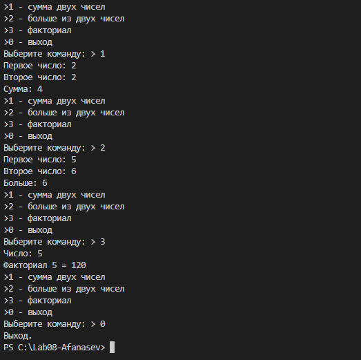
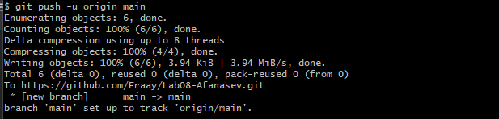

# Практическая работа №8

**ФИО: Афанасьев Глеб Викторович**

**Группа: ИСП-242**

**Дата: 30.10.2026**

## Что изучено

1. Чем void-метод отличается от метода с return

2. Полезное использование методов

3. Правильное использование return и break

4. Как передавать данные в метод через параметры и как вызывать метод с конкретными аргументами

